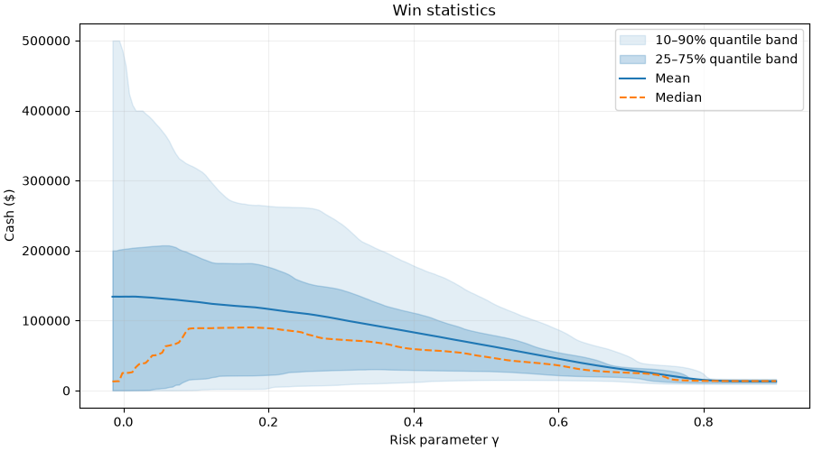
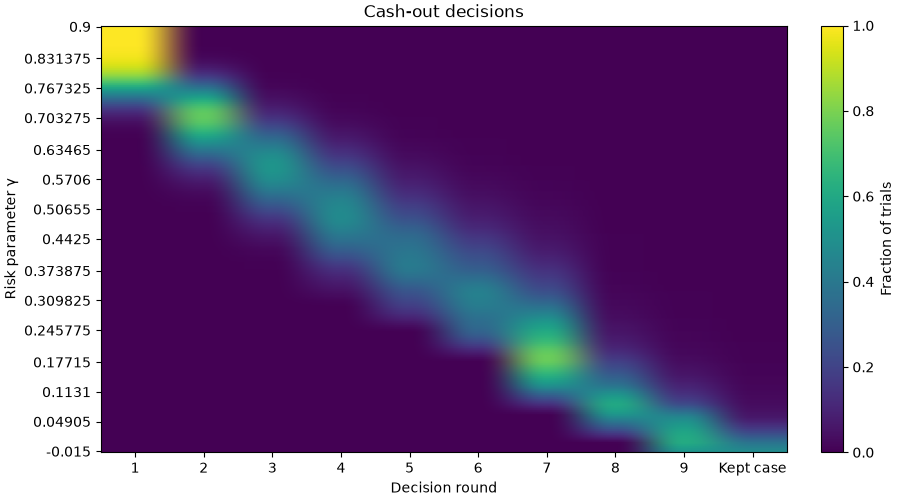

# Results and interpretation

The published experiment uses `examples/research.json`: 100,000 shared game trajectories, 201 CRRA risk levels, and seed 102. A separate summary evaluates the checked-in synthetic piecewise-linear utility agent on those same trajectories. The game and banker assumptions are documented in [methodology](methodology.md).

## Research figures

*Payout statistics across the CRRA grid. Values are derived from integer-cent simulation outcomes; visual summaries display dollars. The stored statistics and quantiles determine the curves.*

*Cash-out timing across the CRRA grid. Agents can accept one of nine banker offers or receive their reserved case after rejecting every offer.*

The CLI also generates threshold-probability, integrated-CDF, and payout-density figures. Regenerate all figures with the commands in [reproduction](reproduction.md). Keep the manifests and configuration with any figures used outside this repository.

## Run record

The run used Rust 1.98.0 and Python 3.14.7 on Linux x86_64, with an Intel Core Ultra 9 275HX and 24 logical CPUs. Dependencies and release binaries were already available. These are single local measurements, not performance guarantees:

| Preset | End-to-end time | Sweep simulation + summaries | Largest process RSS | Generated artifacts |
| --- | ---: | ---: | ---: | ---: |
| Demo | 4.07 s | 0.057 s | 165.01 MiB | 2.40 MiB |
| Research | 10.37 s | 3.889 s | 185.54 MiB | 7.60 MiB |

End-to-end time includes Python startup, both simulations, and all ten PNG/SVG figure pairs. Linux `getrusage(RUSAGE_CHILDREN)` records the maximum process resident memory across measured children; this is neither simultaneous process-tree memory nor the simulator's allocation estimate. The research sweep's payout arrays require 76.68 MiB.

[research-record.json](research-record.json) preserves the source-content hash, result-file SHA-256 hashes, exact measurements, and selected summaries. The hash identifies the code, lockfiles, and experiment inputs of the pre-release source that produced the run. Full result files are regenerated locally rather than committed.

## Selected outcomes

| Agent | Mean payout | Median payout | Kept reserved case |
| --- | ---: | ---: | ---: |
| CRRA, γ = −0.015 | $134,034.94 | $12,934.25 | 47.752% |
| CRRA, γ = 0.4425 | $75,274.25 | $56,247.03 | 0.033% |
| CRRA, γ = 0.9 | $13,152.91 | $13,484.53 | 0% |
| Synthetic piecewise-linear utility | $62,940.56 | $46,229.28 | 0.058% |

The low-gamma agent has a larger mean and much lower median than the middle-grid agent in this experiment. Almost every γ = 0.9 agent accepts the first offer. These results illustrate the tradeoff between payout spread and early certainty under the specified rule. They do not identify an optimal strategy.

Treat small differences between nearby gamma values as Monte Carlo estimates. For an individual mean, the standard error can be estimated as its stored population standard deviation divided by the square root of 100,000. Establishing uncertainty for differences between agents would require retaining paired outcome information; the current summaries do not retain that covariance.

## Reading the comparison

The agents differ in their acceptance rule while sharing complete trajectories. Compare both payout statistics and cash-out timing: a policy's average payout does not summarize its spread, lower tail, or decisions by round. The synthetic model is an illustrative utility curve, not a measured contestant preference.

Threshold probabilities estimate the share of payouts at or above a chosen target. Integrated CDF values estimate expected shortfall below that target. Both are calculated from 1,001 equally weighted quantile points, and therefore approximate the full empirical distribution. A favorable comparison at selected thresholds does not establish stochastic dominance.

The plots apply to this prize board, banker schedule, sample, and gamma grid. They do not demonstrate an optimal playing strategy or predict real contestants' behavior. Earlier generated results are superseded by the corrected engine and are not evidence for the current findings.
